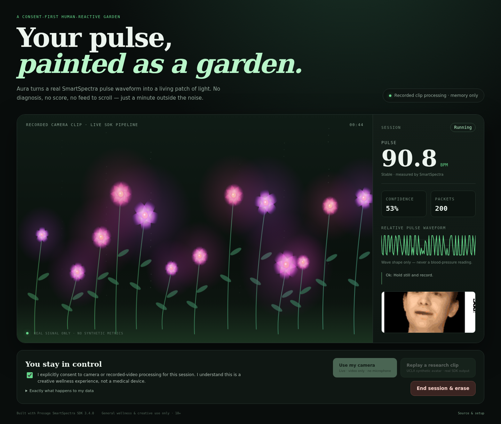

# Aura — your pulse, painted as a garden



Aura is a **consent-first, camera-reactive generative garden** built for the [Presage SmartSpectra SDK Challenge](https://dev.to/challenges/presage-2026-11-04). A real pulse waveform changes the flowers’ glow, sway, bloom and palette. It is a quiet, one-minute creative wellness break — not a diagnosis, a health score, or another dashboard demanding attention.

**[Watch the 69-second real-SDK demo](demo/aura-demo.mp4)** · **SDK:** `@smartspectra/node-sdk` 3.4.0 · **Node:** 20+

## What is real

- The Node SDK processes either **live RGBA camera frames** from the browser or the included **recorded synthetic-avatar camera clip**.
- The app consumes `cardio.pulseRate`, `cardio.arterialPressureTrace`, and (when available) `breathing.upperTrace` / `breathing.rate` through `decodeMetrics`.
- The included reproducible test produced **251 metric packets** and a final accumulated pulse of **80.1 BPM at 53% confidence** from the recorded clip. No metric, waveform, confidence value or timestamp is scripted.
- Pulse needs roughly **12–15 seconds** of usable video. The arterial waveform can arrive earlier. Missing breathing values stay `null`; Aura never fills them with synthetic data.
- The flowers freeze instead of animating on made-up values when the signal becomes stale.

## Quick start

### 1. Install and configure

```bash
git clone https://github.com/jeffreyturov-dev/aura-garden.git
cd aura-garden
npm install
export SMARTSPECTRA_API_KEY='your_key_from_https://physiology.presagetech.com/'
npm test
npm start
# Open http://127.0.0.1:8894
```

No account is needed in Aura itself. A free Presage developer API key is required by the SDK; keep it in the server environment, never in browser code.

### 2. Linux / headless machines: Vulkan

SmartSpectra’s cardio backend requires Vulkan. On a machine without a configured Vulkan driver the SDK fails fast with `kSetupError / Vulkan is not available on this system`. Use a native Vulkan driver where possible.

For Linux x86_64 only, Aura includes an optional **root-free Mesa lavapipe (CPU Vulkan)** setup using pinned Debian packages and SHA-256 verification:

```bash
npm run setup:vulkan
export SMARTSPECTRA_API_KEY='your_key'
npm run start:lavapipe
```

This was the exact setup used for the recorded demo. The packages live under `.local/vulkan/`; nothing is installed system-wide and no `sudo` is needed.

### 3. Try it without a camera

1. Read the consent and data-handling disclosure.
2. Tick the explicit consent checkbox.
3. Choose **Replay a research clip**.
4. Wait about 15 seconds for the first pulse estimate.

The clip is a cropped, H.264-encoded excerpt of the **synthetic rPPG avatar demonstration** published by UCLA’s Vision Lab. It is not footage of a user. See `ATTRIBUTION.md`. Judges can reproduce the full experience with their own Presage key and no webcam.

### 4. Try a live camera

Choose **Use my camera** after consent. Aura requests `getUserMedia({ video, audio: false })`, draws 640×360 frames locally, and sends RGBA pixels over the local WebSocket to `SmartSpectraSDK.sendFrame`. Use soft frontal light, hold still, and keep your face visible. **End session & erase** releases every media track and clears metrics, waveform and canvas state.

## Architecture

```text
Browser (explicit consent)
  ├─ Live camera → RGBA frames ─┐
  └─ Recorded camera clip       │ local WebSocket / HTTP
                                ▼
Node/Express server → SmartSpectraSDK 3.4.0
  ├─ useCustomInput + sendFrame (live mode)
  ├─ useFile (replay mode)
  ├─ decodeMetrics → last real sample per signal
  └─ JSON metrics/validation/status events
                                ▼
Canvas garden + pulse/confidence + relative waveform
```

There is no cloud app backend, database, analytics, login, cookie, or optional AI service. The Presage SDK still requires network access for API-key authentication, subscription validation and encrypted model artifact delivery. Aura sets `enableTelemetry: false`. Metric computation is performed on-device by SmartSpectra. Aura does not upload raw camera frames to Presage or any third party.

## Reproduce the recorded demo

With the server running on port 8894:

```bash
# one-time browser install; choose a writable cache if needed
npx playwright install chromium
node scripts/record-demo.js test-artifacts/replay
```

The script verifies that the demo button is disabled before consent, records the entire browser session, samples the DOM every two seconds, and fails unless it observes more than 100 real metric packets and a numeric pulse. The checked-in `demo/run.json` is the actual run log. Convert the resulting WebM to MP4 with:

```bash
ffmpeg -i test-artifacts/replay/aura-demo.webm -c:v libx264 -crf 18 -pix_fmt yuv420p -movflags +faststart aura-demo.mp4
```

For a lower-level SDK proof without the UI:

```bash
SMARTSPECTRA_API_KEY='your_key' node scripts/file-measurement.js \
  test-assets/ucla-avatar-1.mp4 measurement.json
```

## Tests

```bash
npm test
```

Tests cover SmartSpectra payload decoding, `null` preservation, session erasure, bounded garden mappings, disabled-before-consent controls, video-only capture, and absence of third-party browser assets. The Playwright recording is the end-to-end integration test against the real SDK.

## Consent, retention and limitations

- Explicit opt-in is required before either source can start.
- Live metrics remain in server/browser memory only and are reset on stop. The app has no persistence layer.
- The optional recording developer script intentionally saves a session video and run log; it is never triggered by the app or by a user session.
- No microphone access, raw-video upload, covert capture, emotion inference, diagnosis, treatment, or medical decision-making.
- Pulse confidence and stability come directly from SmartSpectra. The waveform is labelled **relative** and is never presented as a blood-pressure value.
- Creative/general-wellness experience for adults. Low-quality lighting, movement, compression and device capability affect results. Recorded-file mode validates the real SDK pipeline, but it is not proof of accuracy on a live person.

## References

- [SmartSpectra Node.js documentation](https://smartspectra.presagetech.com/docs/nodejs)
- [Telemetry and privacy](https://smartspectra.presagetech.com/docs/telemetry-and-privacy)
- [SDK API reference](https://smartspectra.presagetech.com/docs/nodejs/api-reference)
- [UCLA rPPG avatars research and sample](http://visual.ee.ucla.edu/rppg_avatars.htm/)

MIT license applies to Aura’s original code. Presage SDK and the UCLA research clip retain their own terms.
