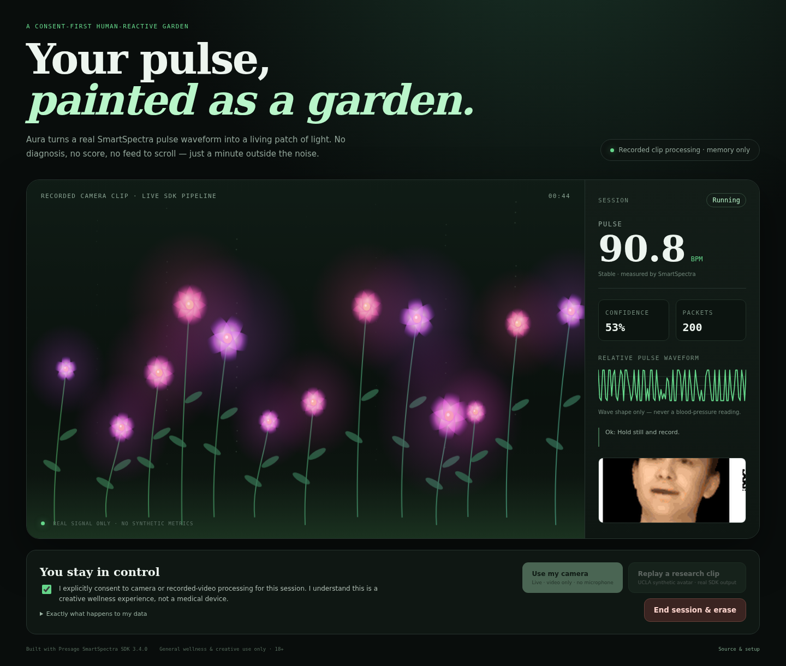

*This is a submission for the [Presage SmartSpectra SDK Challenge](https://dev.to/challenges/presage-2026-11-04).*

## What I Built

**Aura is a small generative garden that wakes up only when Presage SmartSpectra delivers a real human signal.** A pulse waveform changes the flowers’ glow, sway and bloom; pulse relative to the session baseline shifts the palette. When the signal stops, the flowers freeze rather than performing a fake heartbeat.

I wanted to make sensing feel less like surveillance and less like another score to optimize. Aura is a one-minute creative wellness break: no streak, diagnosis, account, feed, or microphone. Just a patch of light that responds to you and disappears when you ask it to.



## Demo

**[Watch the 69-second demo video (MP4)](https://github.com/jeffreyturov-dev/aura-garden/blob/main/demo/aura-demo.mp4)**

The video shows the consent gate, the recorded-camera replay, the first delayed pulse estimates, changing confidence values, the live relative waveform and the reactive garden. This is not a prerecorded metrics animation: the run observed **251 SmartSpectra metric packets**, ending with an accumulated **80.1 BPM at 53% confidence**. The [actual two-second DOM sample log is public](https://github.com/jeffreyturov-dev/aura-garden/blob/main/demo/run.json).

For reproducibility without a webcam, the app includes a transformed **synthetic rPPG avatar research clip from UCLA**, with attribution. It is not footage of a user. The same app also supports a live webcam through custom RGBA frames. Recorded-file mode demonstrates the real SDK pipeline, but I do not present it as proof of accuracy on a live person.

## Code

**Repository:** [github.com/jeffreyturov-dev/aura-garden](https://github.com/jeffreyturov-dev/aura-garden)

The README includes installation, a free Presage API-key setup, unit tests, real-SDK measurement commands, Playwright demo reproduction, and an optional root-free CPU Vulkan setup for headless Linux.

## How It Responds to Human Signals

Aura uses `@smartspectra/node-sdk` **3.4.0** in two genuine SDK input modes:

```js
// Live browser camera → local WebSocket → SDK custom input
sdk.useCustomInput(FrameTransform.kNone);
sdk.sendFrame(rgba, width, height, width * 4, PixelFormat.kRGBA, timestampUs);

// Reproducible recorded camera clip
sdk.useFile(demoPath, { interframeDelayMs: 33 });
sdk.start();
```

The server requests breathing and cardio bundles and decodes each real metrics buffer:

```js
sdk.on('metrics', (buffer, timestampUs) => {
  const metrics = decodeMetrics(buffer);
  const state = metricsState.ingest(metrics);
  broadcast({ type: 'metrics', timestampUs, ...state });
});
```

The visual mapping uses:

- `cardio.pulseRate`: BPM, confidence and stability display, plus gradual palette/bloom changes relative to a median session baseline;
- `cardio.arterialPressureTrace`: a **relative waveform only** and the flowers’ instantaneous energy/sway;
- `breathing.upperTrace` and `breathing.rate`: additional movement only when a real value exists.

One detail mattered: SDK windows do not all contain every metric. `null` must remain `null`. Aura retains the last real sample per signal but never invents a missing pulse or breathing value. If packets become stale, the rendering freezes.

### The practical issue I hit

The official docs made custom input and file mode look straightforward, but my first cardio run stopped after two seconds with:

```text
kSetupError: Vulkan is not available on this system.
```

The fix was not a mock adapter. I ran the SDK with Mesa lavapipe, extracted from pinned Debian packages into a user-writable directory with SHA-256 checks. `npm run setup:vulkan` and `npm run start:lavapipe` reproduce that root-free setup on Linux x86_64. Native Vulkan is still preferred where available.

The second timing detail is important for judges: the first pulse can take **12–15 seconds**. Aura says so in the UI instead of filling the wait with random numbers.

## Prize Categories

### Most Creative or Delightful Use

Aura turns an invisible physiological trace into a small living place rather than a chart. The garden’s visual “breath” comes from actual SDK packets; its restraint is part of the design. There is no simulated garden performing behind the interface while the camera is off.

### Best Thoughtful Real-World Use

The intended use is a brief, opt-in creative pause for adults who want an ambient experience without creating an account or storing a health history. The controls use plain language, explain the initial delay, expose confidence, and provide one obvious **End session & erase** action. It deliberately avoids stress labels, diagnoses and medical decisions.

## Consent and Data Handling

- **Consent:** neither source can start until the user reads the disclosure and ticks an explicit consent checkbox. Starting a source is a second, separate action.
- **Camera:** live mode requests `getUserMedia({ video, audio: false })`. There is no microphone request, background capture or covert monitoring.
- **Processing:** SmartSpectra performs metric computation on-device. Aura sends live RGBA frames only from the browser to its local Node process via the local WebSocket.
- **Network:** the SDK requires network access for API-key authentication, subscription validation and encrypted model artifact delivery. Aura does not upload raw camera frames to Presage or any other third party.
- **Telemetry:** the SDK is initialized with `enableTelemetry: false`.
- **Storage and retention:** the application has no account, cookie, analytics, database or cloud app backend. Live metrics remain in browser/server memory. Stop releases all media tracks and clears metrics, waveform and garden state.
- **Sharing and deletion:** there is no automatic export or sharing. **End session & erase** clears the session. Closing/reloading also releases local media.
- **Developer recording:** the separate Playwright script intentionally saves the public demo and its run log. It is never triggered by a normal user session.
- **Optional AI services:** none are used at runtime.
- **Safety:** Aura is a creative/general-wellness experience for adults. It makes no diagnosis or treatment claim and does not support medical decision-making. The waveform is explicitly labelled relative and never as a blood-pressure reading.

## Validation

`npm test` checks real SDK payload handling, null preservation, erasure, bounded visual mappings and consent-gated controls. The Playwright run is an end-to-end test against the actual SDK and fails unless it sees more than 100 metric packets and a numeric pulse. There were no browser console errors in the checked-in final run.

Thanks to Presage for the SDK and to UCLA’s Vision Lab for publishing the synthetic rPPG avatar research demonstration used for reproducible testing.
